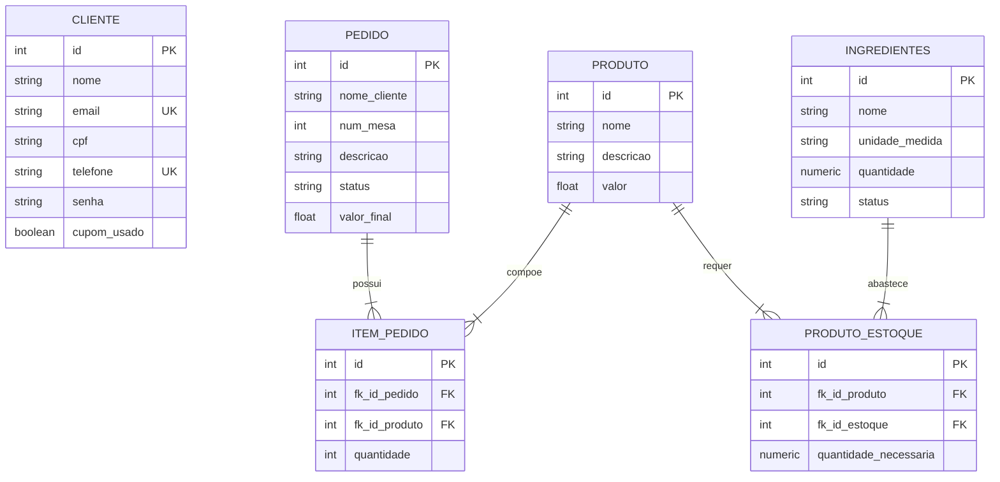

# Especificação de Requisitos de Software (SRS) 📋
## Software Requirements Specification (SRS)

\[pt-br\] | [en](#-english-version)

---

## 🇧🇷 Versão em Português

### 1. 📌 Introdução e Visão Geral do Sistema

O **Catatau Lanches** (projeto **DB-Jinja2-Python**) é uma aplicação web full-stack desenvolvida em Python utilizando o framework **FastAPI**, o motor de templates **Jinja2** para renderização server-side (SSR) e o ORM **SQLAlchemy** integrado ao banco de dados relacional **Microsoft SQL Server (LocalDB)** via **pyodbc**.

O objetivo do sistema é fornecer uma experiência completa de autoatendimento e pedidos para uma hamburgueria, abrangendo desde o cadastro e login de clientes, visualização interativa do cardápio, gestão de carrinho de compras baseado em cookies, aplicação de cupons promocionais de boas-vindas, envio do pedido para a fila de preparo da cozinha e baixa automatizada no estoque de insumos/ingredientes.

---

### 2. ⚠️ Status do Projeto: Versão Beta (v0.x)

Este projeto encontra-se atualmente em **versão beta**. Isso significa que:
* As funcionalidades essenciais de fluxo de compras e cadastro estão operacionais e integradas ao banco de dados.
* O sistema reflete um protótipo avançado e funcional (MVP/Beta), pronto para experimentação local.
* Há **ideias futuras**, melhorias arquiteturais e débitos técnicos mapeados para versões posteriores (como criptografia de senhas, autenticação JWT, websockets para a cozinha e gateways de pagamento), os quais estão documentados na [Seção 7](#7-ideias-futuras-e-débitos-técnicos-roadmap).

---

### 3. ✨ Requisitos Funcionais (RF)

| ID | Nome | Descrição | Atores | Prioridade |
| :--- | :--- | :--- | :--- | :--- |
| **RF01** | Cadastro de Clientes | O sistema deve permitir que novos clientes criem uma conta informando Nome, E-mail, CPF, Telefone (DDD + número) e Senha com confirmação. | Visitante | Alta |
| **RF02** | Validação de Duplicidade de Cadastro | O sistema deve impedir cadastros com Nomes ou CPFs já existentes no banco de dados, exibindo mensagem amigável de erro. | Sistema | Alta |
| **RF03** | Autenticação / Login | O sistema deve permitir login utilizando Nome de Usuário ou E-mail juntamente com a Senha cadastrada. | Cliente | Alta |
| **RF04** | Gestão de Sessão via Cookies | Ao autenticar com sucesso, o sistema deve registrar um cookie seguro (`user_id`, `HttpOnly`, `SameSite=Lax`, expiração de 1 hora) para manter o usuário conectado entre requisições. | Sistema | Alta |
| **RF05** | Encerramento de Sessão (Logout) | O sistema deve permitir ao cliente efetuar logout, invalidando e removendo o cookie `user_id` e redirecionando para a página principal. | Cliente | Média |
| **RF06** | Visualização do Cardápio | O sistema deve disponibilizar um catálogo visual dos lanches disponíveis, exibindo foto, nome, descrição e valor unitário. | Visitante, Cliente | Alta |
| **RF07** | Detalhes do Produto | O sistema deve renderizar páginas individuais para cada produto através de rota dinâmica (`/lanche/{nome}`), apresentando informações detalhadas e botão de compra. | Visitante, Cliente | Média |
| **RF08** | Carrinho de Compras em Cookie | O sistema deve permitir adicionar, incrementar, decrementar e remover itens do carrinho de compras sem necessidade de autenticação prévia, persistindo os itens em cookie JSON (`carrinho_catatau`). | Visitante, Cliente | Alta |
| **RF09** | Sistema de Cupons Promocionais | O sistema deve validar e aplicar cupons de boas-vindas (`BEMVINDO30` ou `CATATAU30`) com 30% de desconto sobre o subtotal do carrinho, exclusivamente para a primeira compra de clientes cadastrados e autenticados. | Cliente | Alta |
| **RF10** | Consulta Assíncrona de Cupons | O sistema deve expor uma API (`POST /api/validar-cupom`) para validação dinâmica de cupons, retornando JSON com o percentual, valor de desconto e total recalculado. | Cliente, Frontend | Média |
| **RF11** | Tela de Checkout e Resumo | O sistema deve exibir tela de checkout consolidando itens do carrinho, subtotal, campo para aplicação/remoção de cupom, desconto obtido, seleção do número da mesa e observações para a cozinha. | Cliente | Alta |
| **RF12** | Envio de Pedido à Cozinha | O sistema deve processar o pedido final, registrando-o na tabela `pedido` com status `ESPERANDO`, associando os itens na tabela `itens_pedido` e limpando o cookie do carrinho. | Cliente | Alta |
| **RF13** | Baixa Automática no Estoque | No momento em que um pedido é enviado à cozinha, o sistema deve consultar a ficha técnica do produto (`produto_estoque`) e deduzir automaticamente as quantidades correspondentes de cada insumo na tabela `ingredientes`. | Sistema | Alta |
| **RF14** | Perfil do Usuário | O sistema deve disponibilizar a rota `/usuario/{nome}` exibindo dados cadastrais do cliente (nome, e-mail, CPF, telefone e status de uso do cupom promocional). | Cliente | Média |
| **RF15** | Painel Administrativo Básico | O sistema deve disponibilizar uma rota administrativa (`/administrator`) que lista todos os clientes cadastrados em formato JSON. | Administrador | Baixa |
| **RF16** | Notificação de Pedido Enviado | Após o checkout, o cliente deve ser redirecionado para a página inicial recebendo um alerta visual indicando que o lanche foi enviado para a cozinha com estimativa de entrega de 10 minutos. | Cliente | Média |

---

### 4. ⚙️ Requisitos Não Funcionais (RNF)

| ID | Categoria | Descrição | Métrica / Critério |
| :--- | :--- | :--- | :--- |
| **RNF01** | **Arquitetura & Desempenho** | A aplicação deve ser construída sobre o framework assíncrono FastAPI e executada através do servidor ASGI Uvicorn para garantir alta vazão e baixo tempo de resposta. | Latência média < 150ms em ambiente local. |
| **RNF02** | **Persistência de Dados** | Utilização do banco de dados relacional Microsoft SQL Server (LocalDB) com suporte a transações ACID via SQLAlchemy ORM e driver oficial `pyodbc`. | Transações atômicas com `commit` e `rollback`. |
| **RNF03** | **Segurança de Transporte de Sessão** | O cookie de identificação do usuário (`user_id`) deve ser configurado com as diretivas `HttpOnly=True` e `SameSite=Lax` para mitigar ataques XSS e CSRF. | Não acessível via `document.cookie` no client. |
| **RNF04** | **Renderização Server-Side (SSR)** | A camada visual deve ser renderizada pelo servidor com Jinja2Templates, permitindo injeção limpa de dados e reaproveitamento de componentes HTML. | Templates modulares desacoplados das regras de negócio. |
| **RNF05** | **Compatibilidade de Ambiente** | O projeto deve ser compatível com ambientes Windows rodando Python 3.8+ e possuir suporte a drivers ODBC SQL Server (ODBC Driver 17 for SQL Server). | Execução padrão no Windows com PowerShell/CMD. |
| **RNF06** | **Modularidade de Estilos (CSS)** | A estilização deve ser segmentada em folhas de estilo CSS dedicadas por módulo (`checkout.css`, `cupons.css`, `style.css`, etc.) na pasta `static/css/`. | Arquivos estáticos servidos via `FastAPI.staticfiles.StaticFiles`. |
| **RNF07** | **Estado Descentralizado do Carrinho** | O carrinho de compras não deve sobrecarregar o banco de dados antes da conclusão da compra, sendo mantido inteiramente no cliente via cookies serializados em JSON. | Cookie leve com limite típico de 4KB do navegador. |

---

### 5. 📏 Regras de Negócio (RN)

* **RN01 - Unicidade Cadastral:** Cada cliente deve ter um CPF e um Nome únicos na tabela `cliente`. Caso já exista registro com o mesmo CPF ou Nome, a operação de cadastro deve ser rejeitada.
* **RN02 - Confirmação de Senha:** O cadastro só é aceito se a senha e a confirmação de senha coincidirem exatamente.
* **RN03 - Elegibilidade do Cupom de Boas-Vindas:**
  * O cupom `BEMVINDO30` (ou alias `CATATAU30`) só pode ser concedido a clientes autenticados.
  * O cupom aplica **30% de desconto** sobre o valor total do carrinho.
  * É válido exclusivamente para a **primeira compra**.
  * Imediatamente após a finalização do pedido no checkout, o campo `cupom_usado` do cliente é gravado como `True`, tornando-o inelegível para novas utilizações do mesmo cupom.
* **RN04 - Carrinho Vazio:** Não é permitido enviar pedidos à cozinha se o carrinho estiver vazio. O sistema redireciona automaticamente para o cardápio.
* **RN05 - Integridade de Estoque na Cozinha:** Ao confirmar um pedido com $N$ unidades de um lanche, cada ingrediente vinculado na tabela `produto_estoque` deve ter seu saldo deduzido em:
  $$\Delta Qtd = \text{quantidade\_necessaria} \times N$$
* **RN06 - Status Inicial do Pedido:** Todo pedido gerado deve iniciar obrigatoriamente com o status `"ESPERANDO"`.

---

### 6. 🗄️ Modelo de Dados e Entidades

O banco de dados relacional (`DBCATATAU`) é estruturado em torno das seguintes tabelas:

---

### 7. 🚀 Ideias Futuras e Débitos Técnicos (Roadmap)

Por estar em **Versão Beta**, foram catalogadas as seguintes oportunidades de evolução técnica e novas funcionalidades para as próximas versões:

#### 🔒 Segurança & Autenticação
* **Criptografia de Senhas (Hashing):** Migrar senhas em texto puro para hash seguro com `bcrypt` / `passlib` ou `argon2`.
* **Tokens JWT / Sessão Criptografada:** Substituir o armazenamento direto de `user_id` em cookie simples por tokens JWT assinados ou cookies de sessão com assinatura criptográfica (`itsdangerous`).
* **Proteção CSRF Completa:** Adicionar tokens anti-CSRF nos formulários POST de checkout e cadastro.

#### 🍳 Operação & Cozinha
* **Painel da Cozinha em Tempo Real (KDS):** Interface web para os cozinheiros com atualização ao vivo via **WebSockets**, permitindo avançar status (`ESPERANDO` ➔ `EM PREPARO` ➔ `PRONTO` ➔ `ENTREGUE`).
* **Alerta de Estoque Crítico:** Notificar visualmente ou bloquear lanches caso algum ingrediente esteja com quantidade insuficiente antes da confirmação do pedido.

#### 💳 Pagamento & Delivery
* **Integração de Pagamento Online:** Adicionar gateway para Pix imediato (com QR Code dinâmico) e cartão de crédito.
* **Módulo de Entrega / Delivery:** Além do número da mesa para consumo no local, permitir seleção de modalidade entrega com endereço e cálculo de taxa de entrega.

#### 🏗️ Arquitetura & Manutenibilidade
* **Migração de Banco de Dados (Alembic):** Versionamento automatizado de esquema para facilitar deploys e atualizações.
* **Variáveis de Ambiente (`.env`):** Extrair credenciais do banco de dados e segredos da aplicação para arquivos de configuração e `.env`.
* **Conteinerização com Docker:** Criação de `Dockerfile` e `docker-compose.yml` para facilitar a execução multi-plataforma (Linux, macOS, Windows).
* **Testes Automatizados:** Suíte de testes automatizados com `pytest` e `fastapi.testclient.TestClient`.

---

## 🇺🇸 English Version

### 1. 📌 Introduction & System Overview

**Catatau Lanches** (repository **DB-Jinja2-Python**) is a full-stack web application built with Python using **FastAPI**, **Jinja2** template engine for server-side rendering (SSR), and **SQLAlchemy** ORM integrated with a relational **Microsoft SQL Server (LocalDB)** database via **pyodbc**.

The system powers a complete burger shop self-service and ordering experience, featuring user registration and authentication, interactive visual menu browsing, cookie-based shopping cart management, welcome promotional discount coupons, order dispatching to kitchen queues, and automated ingredient inventory deduction.

---

### 2. ⚠️ Project Status: Beta Version (v0.x)

This project is currently in its **Beta phase**. This entails:
* Core order placement, cart workflows, and customer registration are functional and persisted in SQL Server.
* The system is a working MVP/Beta intended for local testing and active development.
* Several **future ideas**, architectural upgrades, and technical debt items are planned for upcoming releases (such as password hashing, JWT sessions, real-time kitchen WebSockets, and payment gateways), documented in [Section 7](#7-future-ideas--technical-debt-roadmap).

---

### 3. ✨ Functional Requirements (FR)

| ID | Name | Description | Actors | Priority |
| :--- | :--- | :--- | :--- | :--- |
| **FR01** | Customer Registration | The system must allow new customers to sign up with Name, Email, CPF, Phone (Area Code + Number), and Password confirmation. | Guest | High |
| **FR02** | Duplicate Prevention | The system must prevent duplicate registrations for existing Names or CPFs in the database, displaying a clear error message. | System | High |
| **FR03** | Authentication / Login | The system must allow users to log in with either Username or Email along with their Password. | Customer | High |
| **FR04** | Cookie-Based Session Management | Upon successful authentication, the system must set a secure cookie (`user_id`, `HttpOnly`, `SameSite=Lax`, 1-hour expiration) to track login state. | System | High |
| **FR05** | User Logout | The system must allow users to log out by clearing the `user_id` cookie and redirecting to the home page. | Customer | Medium |
| **FR06** | Menu Browsing | The system must render a visual catalog of available burgers and items displaying image, title, description, and price. | Guest, Customer | High |
| **FR07** | Product Detail View | The system must render individual product pages dynamically (`/lanche/{nome}`) with detailed ingredients and purchasing action. | Guest, Customer | Medium |
| **FR08** | Cookie Shopping Cart | The system must allow adding, incrementing, decrementing, and removing cart items without forcing prior login, stored in JSON cookie (`carrinho_catatau`). | Guest, Customer | High |
| **FR09** | Promotional Coupon System | The system must validate and apply welcome coupons (`BEMVINDO30` or `CATATAU30`) granting 30% off on first-time orders for registered, logged-in customers. | Customer | High |
| **FR10** | Async Coupon API | The system must expose an endpoint (`POST /api/validar-cupom`) returning JSON with percentage, discount amount, and updated grand total. | Customer, Frontend | Medium |
| **FR11** | Checkout Screen & Order Summary | The system must display a checkout view consolidating cart items, subtotal, coupon input, discount summary, table number selection, and kitchen notes. | Customer | High |
| **FR12** | Order Dispatch to Kitchen | The system must persist the final order in table `pedido` with status `ESPERANDO`, store order lines in `itens_pedido`, and reset the cart cookie. | Customer | High |
| **FR13** | Automatic Stock Deduction | When an order is submitted to the kitchen, the system must read product recipe definitions (`produto_estoque`) and subtract matching quantities from table `ingredientes`. | System | High |
| **FR14** | Customer Profile Page | The system must provide `/usuario/{nome}` rendering registered details (name, email, CPF, phone, and coupon usage status). | Customer | Medium |
| **FR15** | Basic Admin Endpoint | The system must provide an administrative endpoint (`/administrator`) listing all registered clients in JSON format. | Admin | Low |
| **FR16** | Order Placed Notification | Post-checkout, the customer must be redirected to the home view with a confirmation banner stating the order was sent to the kitchen (10-minute delivery ETA). | Customer | Medium |

---

### 4. ⚙️ Non-Functional Requirements (NFR)

| ID | Category | Description | Metric / Criterion |
| :--- | :--- | :--- | :--- |
| **NFR01** | **Architecture & Speed** | Built on FastAPI and served via ASGI Uvicorn server to ensure high concurrency and rapid response times. | Average local response latency < 150ms. |
| **NFR02** | **Data Persistence** | Relational data persistence on Microsoft SQL Server (LocalDB) ensuring ACID transactions through SQLAlchemy ORM and `pyodbc`. | Atomic commits and transactional rollbacks. |
| **NFR03** | **Session Security** | Authentication cookie (`user_id`) must use `HttpOnly=True` and `SameSite=Lax` flags to mitigate XSS and CSRF risks. | Inaccessible via client-side `document.cookie`. |
| **NFR04** | **Server-Side Rendering (SSR)** | Dynamic HTML generated with Jinja2Templates, separating business logic from view layout. | Clean template structure without inline Python execution. |
| **NFR05** | **Environment Compatibility** | Operable on Windows systems running Python 3.8+ with Microsoft ODBC Driver 17 for SQL Server. | Out-of-the-box Windows PowerShell/CMD execution. |
| **NFR06** | **Modular Styling (CSS)** | CSS styles structured across modular files (`checkout.css`, `cupons.css`, `style.css`, etc.) inside `static/css/`. | Static assets mounted via `FastAPI.staticfiles.StaticFiles`. |
| **NFR07** | **Stateless Cart Storage** | The shopping cart avoids premature database writes by remaining client-side within a JSON-serialized cookie. | Lightweight cookie footprint conforming to browser limits. |

---

### 5. 📏 Business Rules (BR)

* **BR01 - Unique Client Identifiers:** Each customer must have a unique CPF and Name in table `cliente`. Duplicate entries trigger validation errors.
* **BR02 - Password Matching:** Registrations are only processed if the entered password matches the confirmation field.
* **BR03 - Welcome Coupon Eligibility:**
  * Coupons `BEMVINDO30` and `CATATAU30` require an authenticated customer account.
  * The coupon grants a **30% discount** off the cart subtotal.
  * Valid only for the user's **first purchase**.
  * Upon order submission, `cupom_usado` is set to `True`, permanently voiding future reapplication of this discount for that account.
* **BR04 - Empty Cart Guard:** Dispatching an order with zero items is prohibited; the system redirects immediately to `/cardapio`.
* **BR05 - Proportional Inventory Consumption:** For each ordered burger with quantity $N$, required ingredients in `produto_estoque` are subtracted:
  $$\Delta Qty = \text{quantidade\_necessaria} \times N$$
* **BR06 - Default Order Status:** All new orders must be initialized with status `"ESPERANDO"` (Awaiting).

---

### 6. 🗄️ Entity-Relationship Data Model

The relational database (`DBCATATAU`) comprises 6 primary tables:
* **`cliente`**: User accounts, credentials, and coupon state.
* **`produto`**: Menu burgers and products.
* **`pedido`**: Orders with table number, status, notes, and final amount.
* **`itens_pedido`**: Individual order line items linking orders and products.
* **`ingredientes`**: Kitchen raw material inventory and stock levels.
* **`produto_estoque`**: Recipe composition table mapping ingredients required per product.

---

### 7. 🚀 Future Ideas & Technical Debt (Roadmap)

Being in **Beta**, the following roadmap points are planned for future iterations:

#### 🔒 Security & Authentication
* **Password Hashing:** Replace plain-text passwords with industry-standard hashing (`bcrypt` or `argon2`).
* **Signed Sessions / JWT:** Migrate raw `user_id` cookies to cryptographically signed cookies or JWT tokens.
* **CSRF Defense:** Integrate anti-CSRF tokens for all state-changing POST endpoints.

#### 🍳 Kitchen Operations & UX
* **Live Kitchen Display System (KDS):** Real-time web view for cooks powered by **WebSockets** to advance order states (`WAITING` ➔ `PREPARING` ➔ `READY` ➔ `DELIVERED`).
* **Stock Depletion Guards:** Prevent adding or checking out items when ingredients are out of stock.

#### 💳 Payments & Delivery
* **Payment Gateway Integration:** Instant Pix QR Code checkout and credit card processing.
* **Delivery Option:** Delivery fee calculation and address capture alongside dine-in table numbers.

#### 🏗️ Architecture & DevSecOps
* **Alembic Database Migrations:** Automated schema tracking and seamless upgrades.
* **Environment Configuration (`.env`):** Decouple database connection strings and secrets from source code.
* **Docker Containerization:** Dockerfile and Docker Compose configurations for cross-platform deployments.
* **Automated Testing Suite:** Unit and end-to-end integration tests using `pytest` and FastAPI's `TestClient`.
